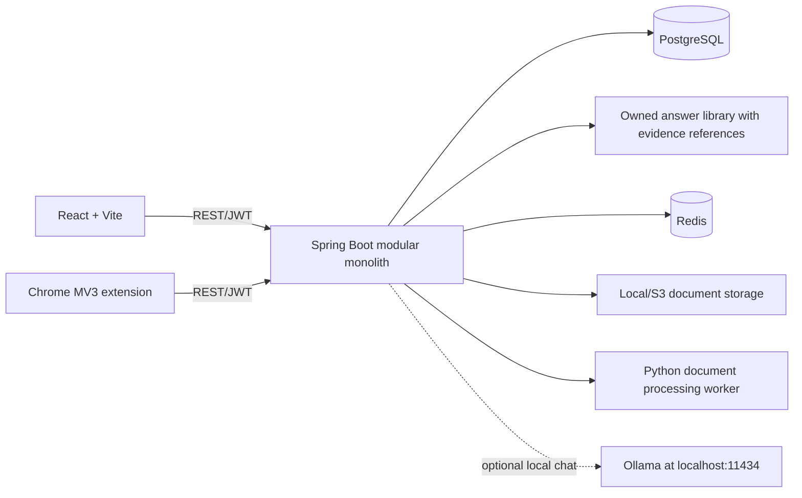

# Architecture

ApplyPilot is a modular monolith: React/TypeScript web client, Java 21 Spring Boot REST API, PostgreSQL/Flyway persistence, Redis for queues/cache, and a Python worker for document processing. A Chrome MV3 extension communicates with the API only after explicit candidate login.

Implemented domain areas include identity, candidate profile, resume intelligence, job discovery/matching, evidence-backed candidate answer library, application bundles, and Phase 4 tracking/intelligence. V10/V11 add immutable resume/answer snapshots, follow-ups, interview preparation/scheduling, skill-gap progress, local notification rows, and notification preferences. Both migrations are applied through Flyway; live PostgreSQL/API checks passed for ownership, snapshots, duplicate prevention, status confirmation, metrics, reminders, interview edits, skill verification, and notification state. The optional interview answer draft service uses only the configured local Ollama provider and supplied resume excerpts; live Ollama inference remains unverified because the service/model is unavailable. Local development uses PostgreSQL, Redis, and local file storage.

The candidate remains responsible for final application submission. The extension prepares only supported form fields, preserves existing entries, and flags uncertain mappings. It uses browser-session token storage and fetches profile data on demand. Its high-confidence marker describes label matching, not independent verification of candidate claims. Legal/work-authorization answers require explicit popup confirmation. Resume attachment retrieves only the selected READY bundle's exact owner-scoped version and attempts to set one unfilled, unambiguous PDF/DOCX upload field after candidate approval. Automated DOM tests cover acceptance simulation and controlled failures; real Chrome and portal acceptance remain NOT TESTED. Bulk preparation uses an owner-scoped atomic API to create distinct job drafts with selected versions and a persisted batch ID. Candidates edit answers and notes in a consolidated review and approve each bundle separately before it becomes READY. The extension still autofills one active employer form at a time and never submits a form or bypasses CAPTCHA/security controls.

The API applies configurable Redis fixed-window request limits to authentication, ingestion, and AI-draft endpoints. Keys hash the direct socket peer address; forwarding headers are ignored. Redis failures fail closed with bounded timeouts. The Nginx web layer adds CSP/security headers, and Compose binds published ports to loopback and requires a database password. These are local-development protections, not a production deployment. Web access/refresh tokens use tab-scoped `sessionStorage`; this reduces persistence after the tab closes but does not prevent same-tab script access. Logout revokes the refresh token, while access JWTs can remain valid until their short expiry. `/api/health` checks PostgreSQL, Redis, and the document worker with a bounded deadline. A Trivy Maven SBOM scan is now implemented in CI and reports two documented transitive Spring findings; the full JSON report remains unfiltered. PostgreSQL-only isolated restore has passed; full resume-volume restoration, production monitoring, deployment, and penetration testing are not complete.

All persistent schema changes are versioned in Flyway. Hibernate schema generation is disabled outside tests.

## Phase 4 and readiness

The Applications workspace now isolates API failures by section, presents accessible loading/error states, explicitly saves editable interview drafts, and exposes cited evidence. Automated component tests and authenticated Playwright journeys cover the core workflow, but do not verify actual-device layout, assistive-technology output, or live Ollama generation. Phase 4 remains in progress until those items are verified.

Web access/refresh tokens are held in tab-scoped `sessionStorage`; the extension flow remains independent. Password-reset tokens travel in the URL fragment and are removed after successful use. Redis-backed rate limiting covers authentication, imports, and AI drafts; it fails closed with bounded Redis connection/command timeouts. `/api/health` checks PostgreSQL, Redis, and the document worker concurrently and has a bounded deadline. Resume parsing preserves uploaded metadata if the worker is unavailable and uses configured connect/request timeouts. E2E and recovery testing use isolated Compose databases and volumes; they never target the primary database. Phase 5 remains in progress; no production deployment is configured or approved.
# Certification Vault (V12; source implemented, primary migration pending)

The vault extends the existing `certifications` table and uses the existing authenticated profile identity. Metadata and private PDF bytes are owner-scoped; PDFs are stored beneath the existing private `app.upload-dir` on the document volume and never exposed as public URLs. Uploads are size- and signature/EOF-checked, hashed, and passed to a scanner interface. The shipped scanner reports `NOT_CONFIGURED` until an operator supplies an implementation. Archive is soft and retains the file.

Resume export and application bundles accept selected certification IDs, copy exact metadata and evidence references into their snapshots, and gate readiness on candidate approval. The PDF is not included in an employer submission. A scheduled job synchronizes configurable, deduplicated in-app expiry reminders with global user preferences. The primary database migration is V12 and remains unapplied pending the normal safeguarded activation.
