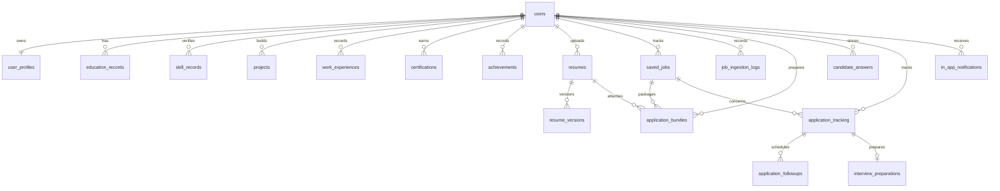

# Database

The PostgreSQL schema is normalized and owned by Flyway migrations under `backend/src/main/resources/db/migration`. User-owned rows reference users and API operations scope records by the authenticated user. Resume versions, application bundles, and audit logs are append-friendly snapshots ensuring candidate data isolation and history integrity.

## Migration Versions
- `V1__identity_profile_resume.sql`: Users, refresh tokens, profiles, education, skills, resumes, and resume versions.
- `V2__hash_storage_types.sql`: Expands resume checksum columns to their persisted string representation.
- `V3__candidate_profile_records.sql`: Projects, work experiences/internships, certifications, and achievements.
- `V4__skill_created_timestamp.sql`: Adds candidate skill record creation timestamps.
- `V5__password_reset_tokens.sql`: Hashed, expiring, single-use password reset tokens.
- `V6__job_discovery.sql`: Opportunity tracking (`saved_jobs` table with match score, pipeline status, and indexes).
- `V7__job_ingestion_and_bundles.sql`:
  - `saved_jobs` extended with `external_job_id`, `job_type`, `required_skills`, `preferred_skills`, `posted_at`, `deadline_at`, `raw_data`.
  - Unique indexes for deduplication by `(user_id, source, external_job_id)` and `(user_id, job_url)`.
  - `job_ingestion_logs` table for tracking RSS/ATS/URL import history and errors.
  - `application_bundles` table connecting candidate, job, tailored resume version, screening answers, required documents, and preparation status (`DRAFT`, `READY`, `IN_REVIEW`, `SUBMITTED_BY_CANDIDATE`).
- `V8__candidate_answer_library.sql`: Candidate-owned reusable answers with required JSON evidence references and update timestamps. Applied and verified against the existing local database on 2026-11-03.
- `V9__application_preparation_batches.sql`: Adds nullable `application_bundles.preparation_batch_id` and a partial user/batch index so grouped draft reviews survive reloads. Existing bundles remain ungrouped; this is a forward-only migration and does not delete or rewrite their data. **Applied successfully** through normal Flyway startup on 2026-11-03; Flyway history reports V9 success.
- `V10__phase4_tracking_intelligence.sql`: Adds unique user/job application tracking records with status timestamps and resume/answer snapshots, follow-ups, interview question/progress storage, per-job skill-gap progress, and local notification records. Composite owner foreign keys and the `(resume_id, version_number)` reference ensure an application can only snapshot an immutable version belonging to its candidate. Job deletion is restricted while an application references it. **APPLIED / PASS** through normal Flyway startup on 2026-11-03.
- `V11__phase4_reminders_and_preferences.sql`: Adds interview scheduling, follow-up update/reminder links, and global notification preferences. **APPLIED / PASS** through normal Flyway startup on 2026-11-03.

Before applying V9, a custom-format PostgreSQL backup was created and archive-verified at `C:\Users\hp\AppData\Local\ApplyPilot\backups\applypilot-pre-v9-20261103-140434.dump`. Only the API service was rebuilt/restarted; PostgreSQL, Redis, web, and the document worker were left running. No named volume was recreated or reset.

Before V10 and V11, custom-format PostgreSQL backups were created and archive-verified at `C:\Users\hp\AppData\Local\ApplyPilot\backups\applypilot-pre-v10-20261103.dump` and `C:\Users\hp\AppData\Local\ApplyPilot\backups\applypilot-pre-v11-20261103.dump`. Existing Flyway version was checked before activation; both migrations were validated and applied by normal API startup. Flyway history records V11 success; it was not edited manually. Recovery preference is a forward corrective migration; restoring a backup rolls back writes made after that backup. PostgreSQL, Redis, and resume volumes were preserved.

Structured job imports persist their source in `saved_jobs.source`, the public posting/application link in `job_url`, the fetch time/source URL in `raw_data`, and the saved time in `saved_at`. RSS/Atom publication time remains in `posted_at`. Company research is a read-only retrieval response; facts are not persisted or added to the schema. The response includes the public source URL and UTC retrieval time for each fact.

Phase 3 resume attachment uses existing owner-scoped `application_bundles.resume_id` and `resume_version_number` references plus immutable `resume_versions`. Bulk preparation creates separate job bundles with a shared batch ID; V9 persists that grouping so pending reviews can be resumed after reload. Existing bundles and volumes are preserved.

Do not remove or reset the named Docker volumes; they contain persistent candidate data.

Phase 4 schema status remains **PASS / APPLIED** through V11. During the Phase 5 continuation, PostgreSQL started successfully, API startup validated all 11 migrations and reported the schema up to date; Flyway records V11 success. Primary aggregate counts remain 40 users, 109 saved jobs, 20 resumes, and 6 applications. The primary named PostgreSQL, Redis, and resume volumes were preserved. A pre-rebuild custom-format backup is at `C:\Users\hp\AppData\Local\ApplyPilot\backups\applypilot-pre-phase5-20261103-182146.dump`; `pg_restore --list` and SHA-256 verification passed. **PASS — Isolated restore drill:** restored this archive into `applypilot-restore-drill-data`, verified Flyway V11, and matched counts (40 users, 109 jobs, 20 resumes, 6 applications). Four application answer snapshots were non-empty, all four resume references joined to the exact stored resume versions, and the archive contains 23 resume version metadata rows. The backup does not contain the separate resume file volume; full document recovery remains untested. No manual Flyway history edits or primary volume changes occurred.
# V12 Certification Vault migration

V12 is an additive migration. It extends the existing V3 `certifications` table (no parallel certification model) with expiry, credential identifiers, verification links, score/self-attestation, reminder preferences, private-file metadata, and soft archive state. It adds deduplication and ownership indexes, certification snapshots/approval flags to bundles and applications, the user notification preference, and owner-linked deduplicated expiry reminders. Existing rows and files are retained; legacy `credential_url` remains available and is used as the official verification URL for vault writes.

**Primary activation status: NOT APPLIED.** The primary database remains at V11. **Isolated verification: PASS.** On 2026-11-06 the current API image validated Flyway V12 against the dedicated `applypilot-e2e` PostgreSQL database, and live certification create/list, duplicate prevention, owner denial, valid/invalid PDF upload, and checksum-verified download checks passed. No primary database, Flyway history, or primary volume was touched. Apply V12 to the primary only through normal Flyway startup after the documented verified backup procedure; do not edit Flyway history manually.
